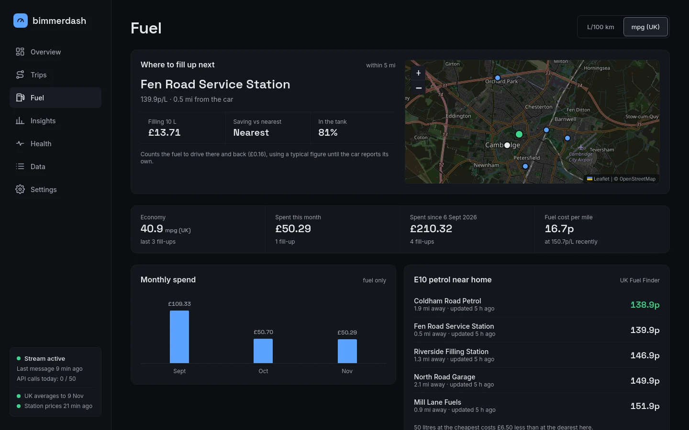
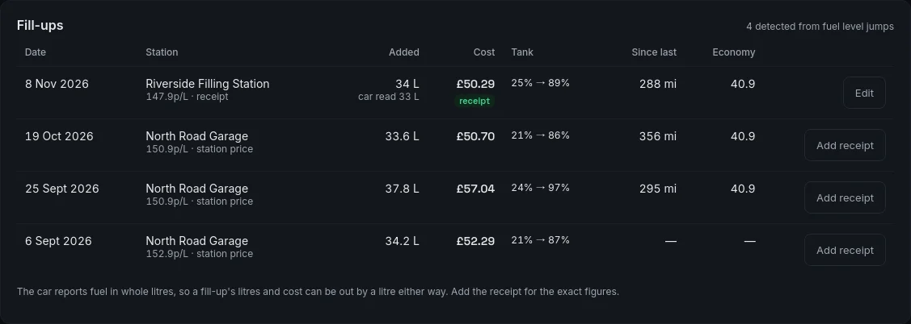
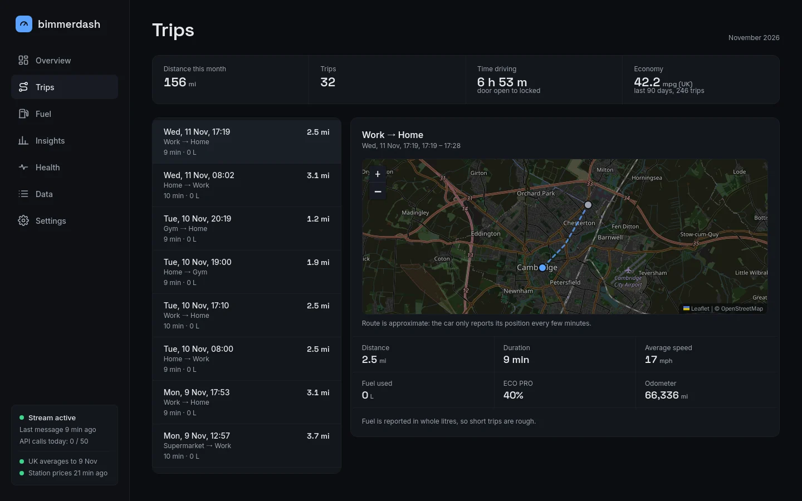
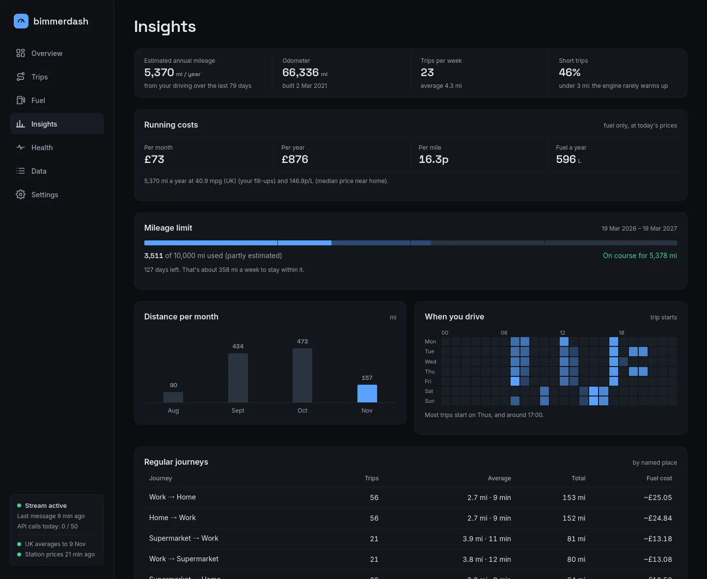
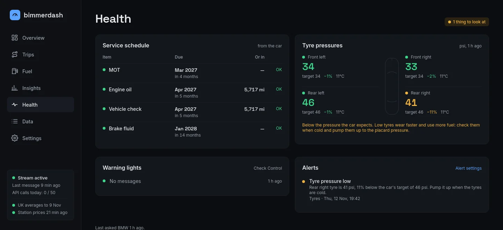
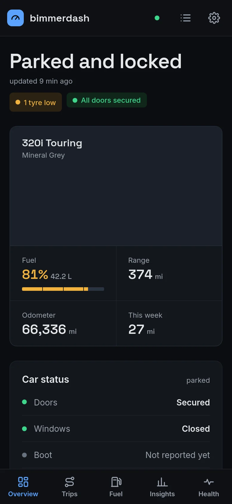
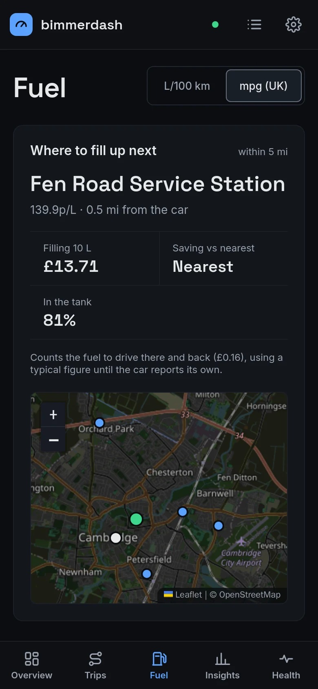

# bimmerdash

**A self-hosted logbook for your BMW.** bimmerdash records your car's data through
BMW's official CarData API and turns it into a private dashboard: what you spend on
fuel, where and how much you drive, and how the car is doing. It's built for petrol and
diesel BMWs, runs on your own server, and keeps everything there.



<sub>Screenshots use made-up demo data.</sub>

Not affiliated with or endorsed by BMW AG. "BMW" is a trademark of BMW AG.

## What it does

### Fuel and running costs

- **Every fill-up, found for you.** bimmerdash spots the jump in the fuel level and
  works out which forecourt you were on. In the UK it prices the fill-up at that
  station's own price on the day, from the government's Fuel Finder data.
- **Exact costs when you want them.** The car reports fuel in whole litres, so a
  detected fill-up can be out by a litre. Type in the receipt and it becomes exact.
- **Where to fill up next.** Stations near the car, ranked by what a fill costs
  including the drive there and back.
- **Economy and cost per mile** from your own fill-ups, monthly spend, and prices near
  home.



### Trips and mileage

- **Every journey**, from unlocking the car to locking it again, with distance, time,
  fuel used, ECO PRO share and a map.
- **Places**: name Home, Work and anywhere else you go, and trips are labelled with them.
- **Insights**: projected annual mileage, a mileage limit tracker for leases and
  insurance, running costs per month and per year, your regular journeys, when you drive,
  and how many trips are too short for the engine to warm up.





### Car health

- **Service schedule and MOT**, as the car reports them, with dates and miles remaining.
- **Tyre pressures** against the car's own target pressure, flagged when one is low.
- **Warning lights** (Check Control messages).
- **Alerts** on the Health page and, optionally, on your phone through Pushover: car left
  unlocked or open, fuel low (with the cheapest station nearby), a tyre low, service or
  MOT due within 30 days, and any warning light.



### On your phone

The whole dashboard works on a phone, in a dark theme that's easy on the eyes.

<p>
  
  &nbsp;
  
</p>

### Also

- Miles or kilometres, mpg (UK) or L/100 km, and your fuel grade (E10, E5, diesel).
- A data explorer showing every value your car sends.
- A login, so the dashboard isn't open to everyone on your network.
- Everything is recalculated from the recorded data, so improvements in new versions
  apply to your past trips and fill-ups too.

## What you need

- A BMW account in a country where BMW offers CarData, with your car added to it.
- A machine that's always on, with Docker and Docker Compose: a home server, a NAS or a
  Raspberry Pi (amd64 and arm64 are both supported).
- For station prices: UK only, with free UK Fuel Finder API access (optional). Without
  it, fill-ups are priced at the UK weekly average and marked **~£ UK avg**.
- For phone alerts: a Pushover account (optional).

## Install

1. **Set up CarData in the BMW portal.** It takes a few minutes:
   [docs/bmw-portal-setup.md](docs/bmw-portal-setup.md)
2. **Configure.** Download `docker-compose.yml` and `.env.example` from this repository
   (or clone it), then:
   ```sh
   cp .env.example .env
   # set BIMMERDASH_CLIENT_ID from the BMW portal, and a database password:
   echo "BIMMERDASH_DB_PASSWORD=$(openssl rand -hex 24)" >> .env
   ```
3. **Sign in to BMW.** A link and a code appear; approve them in your browser. Your BMW
   password never touches bimmerdash.
   ```sh
   docker compose run --rm collector login
   ```
4. **Start it.**
   ```sh
   docker compose up -d
   ```
5. **Open `http://<your-server>:8320` and create your account straight away**, before
   anyone else on your network can (see [Signing in](#signing-in)).

Trips appear after your next drive, and fill-ups after your next visit to a forecourt.

### Updating

```sh
docker compose pull && docker compose up -d
```

The database is upgraded automatically when the new version starts. To stay on a
particular version, set `BIMMERDASH_VERSION` in `.env`. Images are published at
`ghcr.io/downeddart/bimmerdash-collector` and `ghcr.io/downeddart/bimmerdash-web`.

## Settings

Most things are set on the dashboard's **Settings** page: units, fuel grade, tank size,
mileage limit and which alerts you want. The rest lives in `.env`; every option is
described in [`.env.example`](.env.example). The ones you're most likely to want:

| Setting | What it's for |
| --- | --- |
| `BIMMERDASH_FUEL_FINDER_CLIENT_ID`, `..._SECRET` | Station prices (UK Fuel Finder) |
| `BIMMERDASH_PUSHOVER_TOKEN`, `..._USER` | Alerts on your phone |
| `BIMMERDASH_PUBLIC_URL` | A link to the dashboard in each alert |
| `BIMMERDASH_VIN` | Record only one car, if your account has several |
| `BIMMERDASH_WEB_PORT` | Port for the dashboard (default 8320) |
| `BIMMERDASH_REST_POLL_HOURS` | How often to fetch service, tyre and warning data (default every 4 hours) |

## How it works

BMW's CarData sends a live stream of what the car reports: odometer, fuel level,
position, doors and windows, and more. bimmerdash records all of it in a database on your
machine, and works out the rest:

- **A trip** runs from unlocking the car until it's locked from outside, if it moved.
  The car reports its position every few minutes, so routes on the map are approximate.
- **A fill-up** is a rise of 4 litres or more in the fuel level. If the car stopped on a
  forecourt in between, that station's price is used; otherwise the UK weekly average.
- **Economy** comes from the fuel burned between fill-ups, so partial fills work too.
  Cars that report their own fuel counters get an even more precise figure.

A few things never come over the stream (service dates, warning lights, tyre targets),
so bimmerdash asks BMW's API for them every few hours. BMW allows 50 API calls a day;
bimmerdash uses about 6 and never goes past 45.

Want to see what your own car sends? After a drive:

```sh
docker compose run --rm collector keys
docker compose run --rm collector keys --redact   # values hidden, safe to share
```

## Signing in

The first time you open the dashboard it asks you to **create your account**. Do it
straight away: until an account exists, anyone who can reach the page could create one.
You can also create it, or reset a forgotten password, from the command line:

```sh
docker compose exec web bimmerdash-web set-password <username>
```

Sessions last 30 days. Repeated failed logins from one address are blocked for 15
minutes.

**Keep the dashboard on your home network.** To reach it from outside, use a VPN, or put
it behind an HTTPS reverse proxy. Behind a proxy, set `FORWARDED_ALLOW_IPS` to the
proxy's address so bimmerdash sees real client addresses and marks the login cookie
secure. If the proxy already requires its own login (Authelia, Authentik, Cloudflare
Access), you can turn bimmerdash's off with `BIMMERDASH_AUTH=off`; don't otherwise.

**Optional extra protection:** give the dashboard its own database login that can only
change its own settings, not your recorded data:

```sh
echo "BIMMERDASH_WEB_DB_USER=bimmerdash_web" >> .env
echo "BIMMERDASH_WEB_DB_PASSWORD=$(openssl rand -hex 24)" >> .env
docker compose up -d
```

## Privacy

Everything stays on your machine. The only outside services are BMW (your car's data),
the UK government's fuel price feeds, OpenStreetMap (map tiles, loaded by your browser)
and Pushover if you turn it on.

Your database holds your BMW sign-in, your car's VIN and its location history: back it
up, and keep it private. When asking for help, use `keys --redact`, and **don't paste raw
data or logs into public issues**.

## Commands

Run with `docker compose run --rm collector <command>`. You rarely need these: the
collector does all of it on its own.

| Command | What it does |
| --- | --- |
| `login` | Sign in to BMW |
| `keys` | List the values your car sends (`--redact` hides them) |
| `derive` | Recalculate trips and fill-ups now |
| `fetch-vehicle` | Re-fetch the car's details and picture now (2 API calls) |
| `poll` | Fetch service, tyres, warnings and fuel use now (1 API call per car) |
| `import-raw` | Load recorded raw stream files into the database (safe to re-run) |
| `migrate` | Create or upgrade the database (done automatically on start) |

## Contributing

Bug reports and pull requests are welcome. See [docs/development.md](docs/development.md)
for running it from source, tests and dependency updates.

## License

GPL-3.0-only. See [LICENSE](LICENSE).
